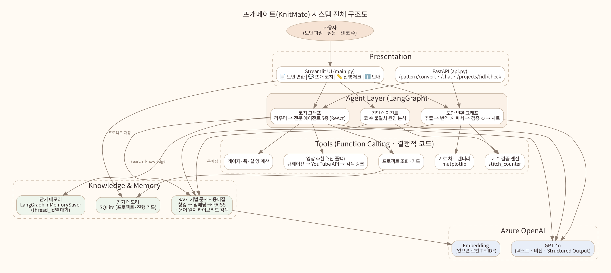
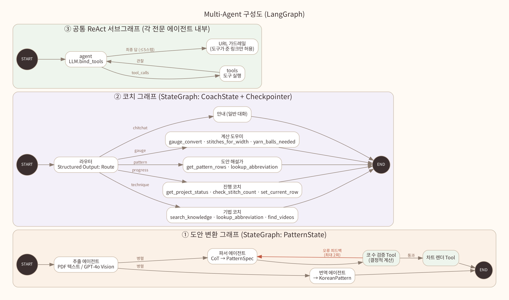
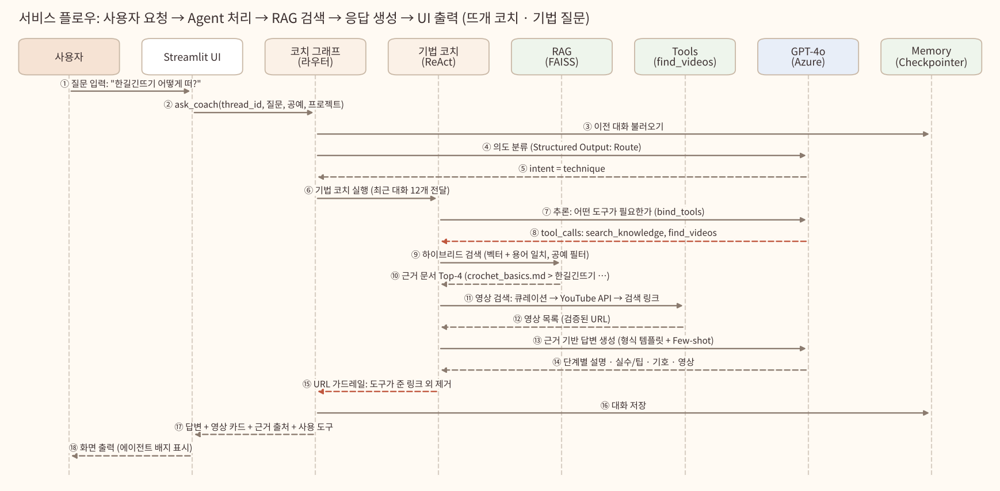
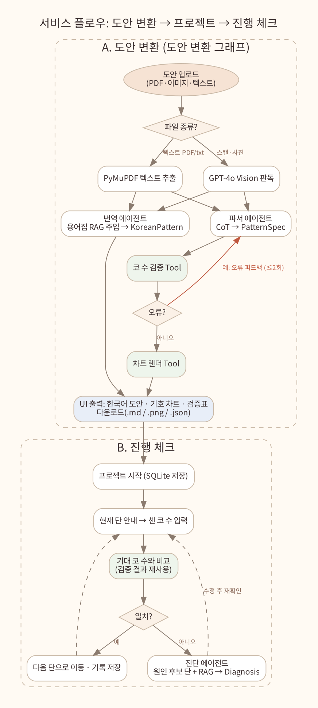
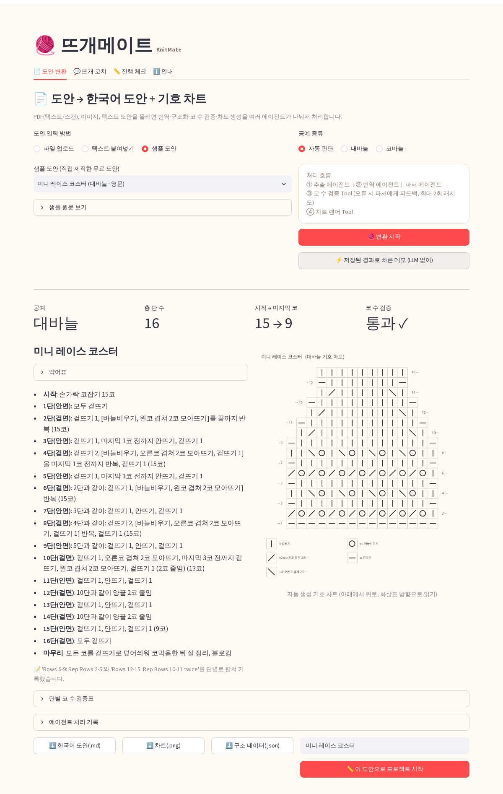
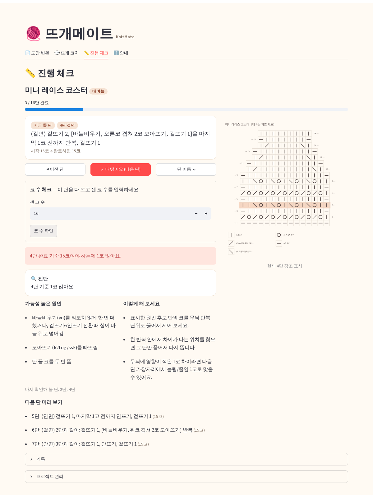
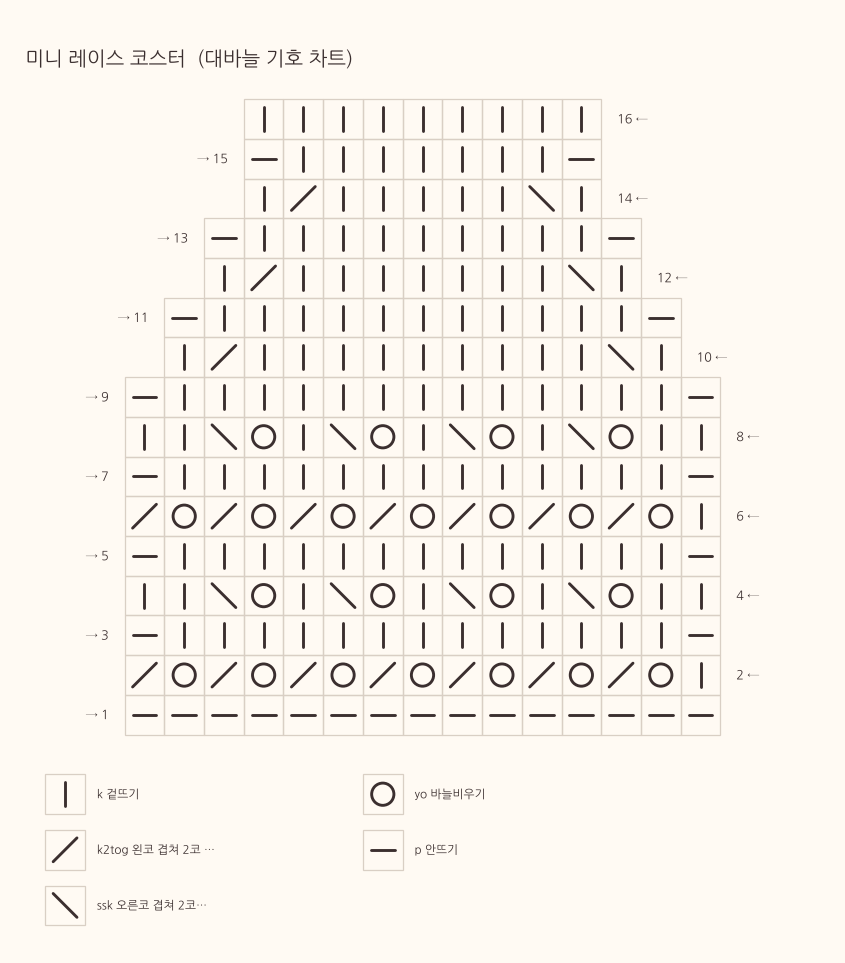
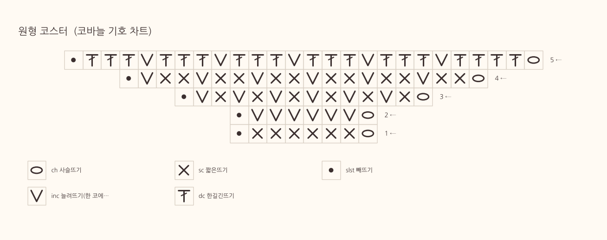

# 뜨개메이트(KnitMate) – 뜨개 도안 해석·코 수 검증 Multi-Agent 코치 – [이름]

---

## 1. 프로젝트 개요 – 기획 배경 및 핵심 내용

### 1.1 프로젝트 기획 배경

**어떤 문제를 해결하고자 하는가?**
- 해외 뜨개 도안은 약어(k2tog, ssk, yo, sc, dc 등)와 반복 표기(`*yo, k2tog; rep from * to last st, k1`)로 쓰여 있어 입문자가 해석하기 어렵습니다.
- 코바늘은 미국식(US)과 영국식(UK) 용어가 같은 이름으로 다른 기법을 가리킵니다(US dc = 한길긴뜨기, UK dc = 짧은뜨기). 잘못 읽으면 작품 크기와 모양이 완전히 달라집니다.
- 뜨는 도중 바늘비우기 하나를 빠뜨리면 몇 단 뒤에야 코 수가 틀린 것을 알게 되고, 어느 단에서 틀렸는지 찾기 어렵습니다.
- 글 도안만 있는 경우 국내 뜨개인에게 익숙한 기호도(차트)가 없어 전체 모양을 파악하기 어렵습니다.

**기존 방식의 한계**
| 기존 방식 | 한계 |
|---|---|
| 번역기·범용 챗봇에 도안 붙여넣기 | 문장 번역만 하고 뜨개 용어를 일관되지 않게 번역, 코 수는 검증하지 않음. LLM이 계산하면 숫자가 틀리기도 함 |
| 블로그·카페 검색 | 기법 설명이 흩어져 있고 지금 뜨는 도안과 연결되지 않음 |
| 종이에 단 수 표시, 단수 카운터 | 단 수만 셀 뿐, 코 수가 맞는지와 틀린 원인은 알려 주지 않음 |
| 영상 검색 | 원하는 기법 영상을 찾는 데 시간이 걸림 |

**Agent 서비스로 해결할 수 있는 Pain Point**
- 도안을 **계산 가능한 구조**로 바꾸고, 계산은 도구(코드)가 맡아 **코 수를 정확히 검증**합니다.
- 검증된 구조로 **기호 차트를 자동 생성**합니다.
- 같은 구조를 **진행 체크**에 다시 써서, 사용자가 센 코 수가 틀리면 원인 후보 단을 짚어 줍니다.
- 질문의 의도에 따라 전문 에이전트(기법·진행·도안 해설·계산)가 근거 문서(RAG)와 도구를 써서 답합니다.

**프로젝트 동기**
직접 뜨개를 하면서 해외 도안을 번역기로 읽다가 코 수가 틀려 여러 번 풀었던 경험에서 출발했습니다. "도안을 읽어 주고, 그려 주고, 뜨는 동안 옆에서 같이 세어 주는 친구"가 있으면 좋겠다는 생각을 Agent 서비스로 구현했습니다.

### 1.2 핵심 아이디어 및 가치 제안 (Value Proposition)

**핵심 기능**
| # | 기능 | 설명 |
|---|---|---|
| F1 | 도안 → 한국어 도안 | PDF(텍스트/스캔), 사진, 텍스트 도안을 읽어 용어집 기준 한국어 도안 작성. US/UK 용어 체계 자동 판단 |
| F2 | 코 수 자동 검증 | 단마다 사용 코·생성 코·반복 횟수를 코드로 계산하고 도안 표기와 대조. 파싱 오류는 자동 재시도로 수정 |
| F3 | 글 도안 → 그림 도안 | 검증된 구조로 대바늘/코바늘 기호 차트(PNG) 생성 |
| F4 | 뜨개 코치(대화) | "한길긴뜨기 어떻게 떠?" → 근거 문서 기반 단계별 설명 + 참고 영상, 도안 해설, 게이지·실 양 계산, 대화 기억 |
| F5 | 진행 체크 | 현재 단 안내 → 센 코 수 입력 → 기대 코 수 비교 → 불일치 시 원인 진단, 기록 저장 |

**사용자 가치와 기대효과**
- 해외 도안 해석 시간 단축, 용어 오해로 인한 실패 감소
- 틀린 단을 일찍 발견해 풀고 다시 뜨는 시간과 실 낭비 감소
- 글 도안을 차트로 보며 전체 모양을 미리 이해
- 기법 설명과 영상을 한곳에서 확인

**기존 서비스 대비 차별성**
1. **LLM은 구조만, 계산은 도구가**: 코 수·반복 횟수·게이지는 결정적 코드로 계산해 숫자 오류가 없습니다.
2. **자기 수정 루프**: 검증 도구가 오류를 찾으면 파서 에이전트에게 피드백해 다시 구조화합니다.
3. **하나의 구조, 세 가지 활용**: 같은 `PatternSpec`으로 검증·차트·진행 체크를 모두 처리합니다.
4. **환각 링크 차단**: 영상 URL은 도구가 만든 것만 허용하고, 그 밖의 YouTube 주소는 답변에서 자동 제거합니다.
5. **외부 API 장애에도 동작**: 임베딩·YouTube API가 없어도 로컬 검색과 검색 링크로 대체됩니다.

### 1.3 대상 사용자 및 기대 사용자 경험 (UX)

**주요 타겟**
- 대바늘·코바늘 입문자~중급 일반 사용자
- 해외 도안(Ravelry 등)을 뜨고 싶은 국내 뜨개인
- 공방 강사(수강생용 한국어 도안·차트 준비)

**사용자 흐름**
1. 도안 업로드 → 한국어 도안, 기호 차트, 단별 코 수 검증표 확인 → 다운로드
2. "이 도안으로 프로젝트 시작" → 진행 체크 탭에서 단마다 지시 확인, 코 수 입력
3. 막히면 뜨개 코치 탭에서 질문 → 설명 + 영상 → 다시 뜨기

**구체적 Benefit**
- 지금 뜰 단의 지시와 "완료하면 몇 코"가 한 화면에 보이고, 차트에서 현재 단이 강조됩니다.
- 코 수가 틀리면 "몇 코 많은지/적은지, 어느 단을 확인할지, 어떻게 고칠지"를 바로 알려 줍니다.
- 기법 답변에 근거 출처와 사용한 도구가 표시되어 신뢰할 수 있습니다.

---

## 2. 기술 구성 – 서비스에 적용할 기술 스택

| 구분 | 기술 |
|---|---|
| LLM | Azure OpenAI GPT-4o (텍스트·비전·Structured Output·Function Calling) |
| Agent | LangGraph 1.x (StateGraph, 병렬 분기, 조건부 루프, 서브그래프, Checkpointer), LangChain Core (Tool, bind_tools) |
| RAG | Azure OpenAI Embedding / 로컬 TF-IDF 폴백, FAISS(IndexFlatIP), 하이브리드 검색 |
| 도구 | PyMuPDF(PDF), matplotlib(차트), SQLite(진행 기록), YouTube Data API(선택) |
| 서비스 | Streamlit(UI), FastAPI(REST), Docker |
| 품질 | pytest(오프라인 단위 테스트 + 가짜 LLM 그래프 테스트), Langfuse 트레이싱(선택) |

### 2.1 Prompt Engineering 전략

**역할 기반 프롬프트** (`knitmate/agents/prompts.py`)
- 에이전트마다 전문가 역할을 부여: "15년 경력 한국어 뜨개 도안 번역가", "도안을 기계가 계산할 수 있는 구조로 바꾸는 파서", "친절한 뜨개 선생님", "뜨개 실수 진단 선생님" 등
- 모든 프롬프트를 **[역할] → [목표] → [규칙] → [절차] → [출력 형식] → [예시]** 골격으로 통일해 입력이 달라도 일관된 응답을 얻습니다.

**CoT / Few-shot**
- **CoT**: 파서 출력 스키마의 첫 필드를 `reasoning`으로 두어 "공예 종류 → 용어 체계 → 시작 코 수 → 반복 구조 → 코바늘 예외 처리" 순서로 분석한 뒤 구조를 쓰게 합니다. 진단 에이전트도 "차이 확인 → 원인 단 찾기 → 가능성 순 정리 → 해결책" 절차를 따릅니다.
- **Few-shot**: 번역(원문→한국어 단 예시 2개), 파서(`Row 4` 구조 예시), 라우터(질문→의도 5개), 기법 코치(질문→도구 호출→답변 형식 예시)에 예시를 넣었습니다.

**출력 구조화 템플릿**
- `PatternSpec`(도안 구조), `KoreanPattern`(한국어 도안), `Route`(의도 분류), `Diagnosis`(진단) Pydantic 스키마로 출력 형식을 고정합니다.
- 기법 코치는 "기법명 / 한 줄 소개 / 뜨는 순서 / 자주 하는 실수·팁 / 도안·차트 표기 / 참고 영상" 마크다운 템플릿으로 답합니다.

**사용자 유형/상황별 프롬프트 분기**
- 라우터가 의도(technique / progress / pattern / gauge / chitchat)를 분류해 서로 다른 시스템 프롬프트와 도구 세트를 가진 에이전트로 보냅니다.
- 사용자 선호 공예(대바늘/코바늘)와 진행 중 프로젝트 유무를 `[현재 상황]`으로 프롬프트에 주입해 답변과 검색 범위를 조정합니다.
- 프로젝트가 없는데 진행 질문을 하면 프로젝트 시작 방법을 안내하도록 분기합니다.
- 용어는 용어집(`glossary.json`)의 한국어 명칭을 그대로 쓰게 해 번역 일관성을 확보합니다.

### 2.2 LangChain / LangGraph 기반 Agent 구조

**Multi-Agent 설계 개념**
- **파이프라인형 협업**(도안 변환): 추출 → 번역 ∥ 파서 → 검증 → (오류 시 파서로 피드백) → 차트
- **라우터(Supervisor)형 협업**(뜨개 코치): 라우터가 질문을 전문 에이전트 5종 중 하나에 배정
- **공통 ReAct 서브그래프**: 각 전문 에이전트는 `agent ⇄ tools` 루프(최대 5스텝)로 동작

**각 Agent의 역할**
| 그래프 | Agent | 역할 | 도구 / 출력 |
|---|---|---|---|
| 도안 변환 | 추출 에이전트 | PDF 텍스트 추출, 스캔본·사진은 비전 판독 | PyMuPDF, GPT-4o Vision |
| 도안 변환 | 번역 에이전트 | 한국어 도안 작성, US/UK 판단 | → `KoreanPattern` |
| 도안 변환 | 파서 에이전트 | 단별 계산 가능한 구조 생성 | → `PatternSpec` |
| 도안 변환 | 코 수 검증 Tool | 단별 코 수 계산·대조, 오류 피드백 생성 | 결정적 코드 |
| 도안 변환 | 차트 렌더 Tool | 기호 차트 생성 | matplotlib |
| 뜨개 코치 | 라우터 | 의도 분류 | → `Route` |
| 뜨개 코치 | 기법 코치 | 기법 설명, 영상 추천 | search_knowledge, lookup_abbreviation, find_videos |
| 뜨개 코치 | 진행 코치 | 현재 단 안내, 코 수 확인·기록 | get_project_status, check_stitch_count, set_current_row, get_pattern_rows |
| 뜨개 코치 | 도안 해설가 | 변환한 도안의 특정 단 해설 | get_pattern_rows, lookup_abbreviation, search_knowledge |
| 뜨개 코치 | 계산 도우미 | 게이지 환산, 폭→코 수, 실 볼 수 | gauge_convert, stitches_for_width, yarn_balls_needed |
| 뜨개 코치 | 안내 | 인사·사용법 | - |
| 진행 체크 | 진단 에이전트 | 코 수 불일치 원인 진단 | RAG + → `Diagnosis` |

**Tool Calling, ReAct, Memory**
- **Tool Calling**: 에이전트용 도구 10개를 `@tool`로 정의하고 `bind_tools`로 GPT-4o가 선택·호출. 도구 오류도 관찰값으로 돌려줘 에이전트가 대처합니다.
- **ReAct**: 추론 → 도구 호출 → 관찰 → 재추론 루프를 LangGraph 서브그래프로 구현, 스텝 한도 도달 시 지금까지 정보로 최종 답변.
- **Memory**
  - 단기: LangGraph `InMemorySaver` 체크포인터로 `thread_id`별 대화 기억 ("그럼 기둥은 몇 코야?" 같은 후속 질문 처리)
  - 장기: SQLite에 프로젝트·현재 단·코 수 기록 저장, 진행 코치가 도구로 읽고 씀
  - 프로젝트 도구는 프로젝트 ID를 클로저로 묶어 생성해 다른 프로젝트에 접근하지 못하게 했습니다.

### 2.3 RAG 구성

**데이터 수집/전처리 파이프라인**
| 데이터 | 내용 | 전처리 |
|---|---|---|
| 기법 문서 5종 (`data/knowledge/*.md`) | 대바늘 기초, 늘림·줄임, 코바늘 기초(US/UK 대조표), 도안 읽는 법, 실 굵기·바늘 호수 | 직접 작성 → `##` 헤딩 단위 청킹, 문서 제목·공예 메타데이터 부여 |
| 용어집 30개 (`data/glossary.json`) | 약어, 한국어/영문명, 별칭(UK 표기 포함), **코 수 규칙**, 차트 기호, 설명 | 용어당 1개 문서로 변환 |
| 영상 큐레이션 (`data/videos.json`) | 기법별 검색어·추천 영상 | 도구가 이름·별칭으로 매칭 |

- 용어집은 검증 엔진·번역·RAG·차트가 함께 쓰는 **단일 출처(Single Source of Truth)** 입니다.

**임베딩 모델 및 Vector DB**
- 임베딩: Azure OpenAI Embedding 배포(`AOAI_DEPLOY_EMBEDDING`). 배포가 없거나 실패하면 **로컬 TF-IDF(단어 + 한글 2-gram, 해싱 2048차원)** 로 자동 대체
- Vector DB: **FAISS** `IndexFlatIP`(정규화 벡터 내적 = 코사인 유사도), `storage/index/`에 저장. FAISS가 없으면 numpy로 대체
- `python build_index.py`로 생성, 앱 첫 실행 시 없으면 자동 생성

**검색 로직과 응답 생성**
- **하이브리드 검색**: 벡터 유사도 상위 40개 → 섹션명·용어 코드가 질문과 정확히 일치하면 가산점(짧은 한국어 용어 검색 보강) → 공예(대바늘/코바늘) 불일치 감점 → Top-k
- 검색 결과를 `[출처: 파일 > 섹션]` 형식으로 에이전트에게 전달, 답변 생성 후 UI에 근거 출처 표시
- 번역·파서 에이전트에는 도안에 실제로 등장한 약어의 용어집 항목만 골라 프롬프트에 주입

### 2.4 서비스 개발 및 패키징 계획

**UI (Streamlit, `main.py`)**
- 탭 4개: 📄 도안 변환 / 💬 뜨개 코치 / 📏 진행 체크 / ℹ️ 안내
- 처리 중 에이전트 단계별 로그 표시(`st.status`), 결과 다운로드(.md/.png/.json), 채팅 답변에 에이전트 배지·영상 카드·근거 출처·사용 도구 표시
- 사이드바: 연결 상태(LLM/임베딩/영상 모드), 선호 공예, 프로젝트 선택

**BE(API) 및 배포**
- FastAPI(`api.py`): `/pattern/convert`, `/pattern/validate`, `/chat`, `/knowledge/search`, `/videos`, `/projects`, `/projects/{id}/check`
- Docker: `python:3.12-slim` 기반 이미지, 빌드 시 인덱스 생성

**설정/환경 관리**
- `.env`로 키 관리, `.env.example` 제공, 키는 ZIP·저장소에 포함하지 않음
- 모든 경로는 프로젝트 루트 기준 상대 경로 → 윈도우 로컬과 리눅스 서버 모두 동작
- 한글 차트 폰트는 `koreanize-matplotlib`(나눔고딕 내장) 패키지로 해결
- `requirements.txt`로 버전 관리, `pytest`로 LLM 없이 검증 가능

### 2.5 선택적 확장 기능

**LLM Fundamentals 기반 Structured Output / Function Calling** ✅ 적용
- 4개 Pydantic 스키마로 구조화 출력(`with_structured_output`, function calling 방식)
- 10개 도구를 Function Calling으로 호출, 계산·검색·프로젝트 조작을 LLM 대신 코드가 수행
- Reasoning 흐름: 파서 CoT 필드 → 검증 → 오류 피드백 → 재구조화(자기 수정)

**MCP 기반 파일·시스템·API 연동** (확장 계획)
- 사용자의 로컬 도안 폴더를 MCP 파일시스템 서버로 연결해 "내 도안 폴더의 모자 도안 변환해 줘" 지원
- 도구 레이어(`agents/tools.py`)가 분리되어 있어 MCP 도구로 교체·추가가 쉬운 구조

**A2A 기반 Agent 협업 구조** (확장 계획)
- 실 쇼핑몰 재고 에이전트와 협업해 필요한 실 양·대체 실 추천
- FastAPI로 이미 에이전트 기능을 외부에 노출하고 있어 A2A 엔드포인트로 확장 가능

---

## 3. 주요 기능 및 동작 시나리오

### 3.1 사용자 시나리오 (Use Case Scenario)

**시나리오 1 – 해외 도안 뜨기**
| 단계 | 사용자 행동 | 서비스 동작 |
|---|---|---|
| 1 | 영문 레이스 코스터 PDF 업로드 | 추출 에이전트가 PDF 텍스트 추출 |
| 2 | "변환 시작" 클릭 | 번역·파서 에이전트 병렬 실행 → 코 수 검증 → 차트 생성, 단계별 로그 표시 |
| 3 | 결과 확인 | 한국어 도안, 약어표, 기호 차트, 16단 모두 통과(15코 → 9코) |
| 4 | 다운로드 / "프로젝트 시작" | .md/.png/.json 저장, SQLite에 프로젝트 생성 |

**시나리오 2 – 뜨는 중 코 수가 이상할 때**
| 단계 | 사용자 행동 | 서비스 동작 |
|---|---|---|
| 1 | 진행 체크 탭 열기 | 현재 4단 지시, "완료하면 15코", 차트에서 4단 강조 |
| 2 | 4단을 뜨고 16 입력 | "15코여야 하는데 1코 많아요" |
| 3 | 진단 확인 | 진단 에이전트: 바늘비우기 중복·모아뜨기 누락 가능성, 2단·4단 확인 권장, 해결 방법 제시 |
| 4 | 수정 후 15 입력 | "정확합니다!" → 5단으로 자동 이동, 기록 저장 |

**시나리오 3 – 기법 질문**
| 단계 | 사용자 행동 | 서비스 동작 |
|---|---|---|
| 1 | "한길긴뜨기 어떻게 떠?" | 라우터 → 기법 코치 |
| 2 | (대기) | search_knowledge로 근거 문서 검색, find_videos로 영상 검색 |
| 3 | 답변 확인 | 단계별 뜨는 법, 자주 하는 실수(기둥 사슬), 차트 기호, 영상 링크, 근거 출처 |
| 4 | "그럼 기둥은 몇 코야?" | 대화 메모리로 맥락 유지, "사슬 3코, 첫 1코로 셈" |

### 3.2 시스템 구조도 / Multi-Agent 다이어그램

**시스템 전체 구조도** — `docs/images/3_2_system_architecture.png`



**Multi-Agent 구성도 (LangGraph)** — `docs/images/3_2_multi_agent.png`



### 3.3 서비스 플로우

**뜨개 코치: 사용자 요청 → Agent 처리 → RAG 검색 → 응답 생성 → UI 출력 (Sequence Diagram)** — `docs/images/3_3_service_flow_coach.png`



**도안 변환 → 프로젝트 → 진행 체크 (Flow Chart)** — `docs/images/3_3_service_flow_pattern.png`



---

## 4. 실행 결과

### 4.1 서비스 실행 결과 (text)

**① 지식 인덱스 생성 (`python build_index.py`)**
```
[RAG] 문서 64개 인덱싱 완료 (임베딩: tfidf, FAISS: 사용)
  검색 테스트 '한길긴뜨기 어떻게 떠?' → glossary.json > 한길긴뜨기 (0.699)
  검색 테스트 'k2tog' → glossary.json > 왼코 겹쳐 2코 모아뜨기 (0.401)
  검색 테스트 '게이지 재는 법' → knit_basics.md > 게이지 (Gauge) (0.517)
```

**② 테스트 (`python -m pytest tests -v`)** — 그래프 흐름(병렬 분기, 검증 피드백 재파싱, ReAct 도구 호출, URL 가드레일, 대화 메모리)과 핵심 도구 검증
```
tests/test_agents_mock.py::test_pattern_pipeline_repair_loop PASSED
tests/test_agents_mock.py::test_coach_react_and_url_guard PASSED
tests/test_core.py::test_knit_sample_counts PASSED
tests/test_core.py::test_crochet_sample_counts PASSED
tests/test_core.py::test_detects_wrong_stated_count PASSED
tests/test_core.py::test_repeat_not_divisible PASSED
tests/test_core.py::test_progress_compare PASSED
tests/test_core.py::test_rag_finds_technique PASSED
tests/test_core.py::test_video_fallback_link PASSED
tests/test_core.py::test_chart_png PASSED
============================== 10 passed ==============================
```

**③ 코 수 검증 결과 (원형 코스터, 코바늘 US)**
```
총 5단, 마지막 코 수 30코
✓ 1단: 0→6코 / 도안 표기 6
✓ 2단: 6→12코 / 도안 표기 12
✓ 3단: 12→18코 / 도안 표기 18
✓ 4단: 18→24코 / 도안 표기 24
✓ 5단: 24→30코 / 도안 표기 30
```

**④ 실행 방법**
```
pip install -r requirements.txt
cp .env.example .env      # Azure OpenAI 값 입력
streamlit run main.py
```

### 4.2 데모 이미지

**도안 변환 결과** (미니 레이스 코스터: 한국어 도안 + 기호 차트 + 검증 통과) — `docs/images/4_result_convert.png`



**진행 체크 – 코 수 불일치 진단** (4단 16코 입력 → 1코 많음 → 원인·해결책·확인할 단, 차트에 현재 단 강조) — `docs/images/4_result_diagnosis.png`



**자동 생성 기호 차트** — `docs/images/4_chart_knit.png`, `docs/images/4_chart_crochet.png`




**뜨개 코치 대화 화면** — [Azure OpenAI 연결 후 "한길긴뜨기 어떻게 떠?" 질문 화면 캡처 추가]

---

## 5. 추가 아이디어

- **원형 차트 렌더러**: 코바늘 원형 도안을 극좌표 방사형 차트로 표시
- **사진으로 코·단 수 세기**: 비전 모델로 편물 사진에서 코·단 수를 추정('추정치' 표시 + 사용자 수정)
- **음성 진행 모드**: 손이 바쁜 뜨개 특성상 "한 단 끝" 음성 입력으로 단 수 증가와 다음 단 읽어 주기
- **게이지 맞춤 도안 변환**: 내 게이지와 원하는 사이즈를 입력하면 코 수·단 수를 자동으로 다시 계산한 도안 생성
- **영상 큐레이션 관리 화면**: 사용자가 추천 영상을 등록·평가해 RAG 데이터 품질 향상
- **MCP·A2A 확장**: 로컬 도안 폴더 연동(MCP), 실 쇼핑몰 에이전트와 실 양·대체 실 추천 협업(A2A)
- **도안 PDF 내보내기**: 한국어 도안 + 차트를 한 장의 인쇄용 PDF로 생성
- **저작권 보호**: 변환 결과는 개인 학습용으로만 저장하고 원작자 표기를 자동 삽입
